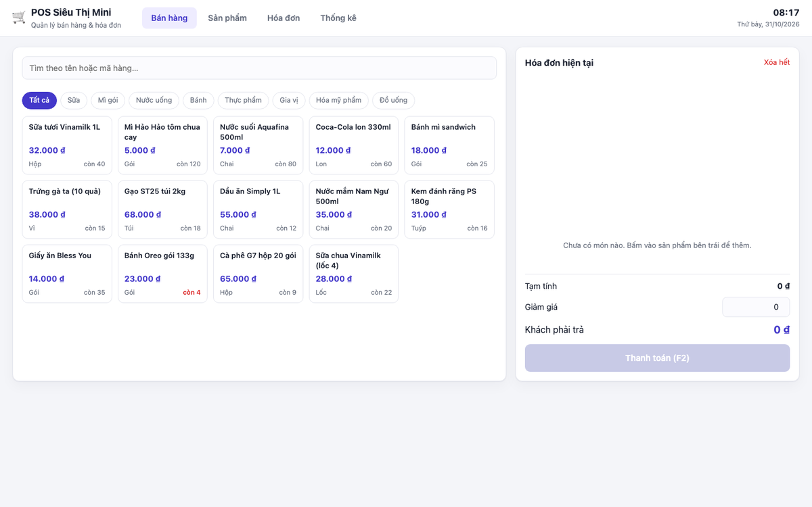
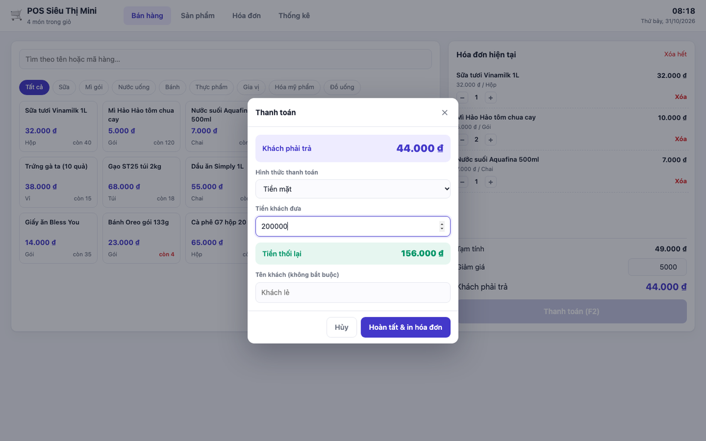
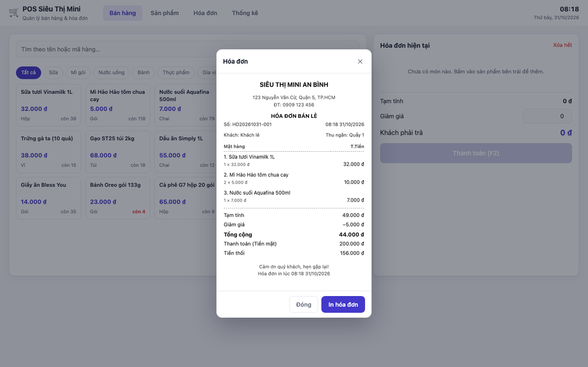
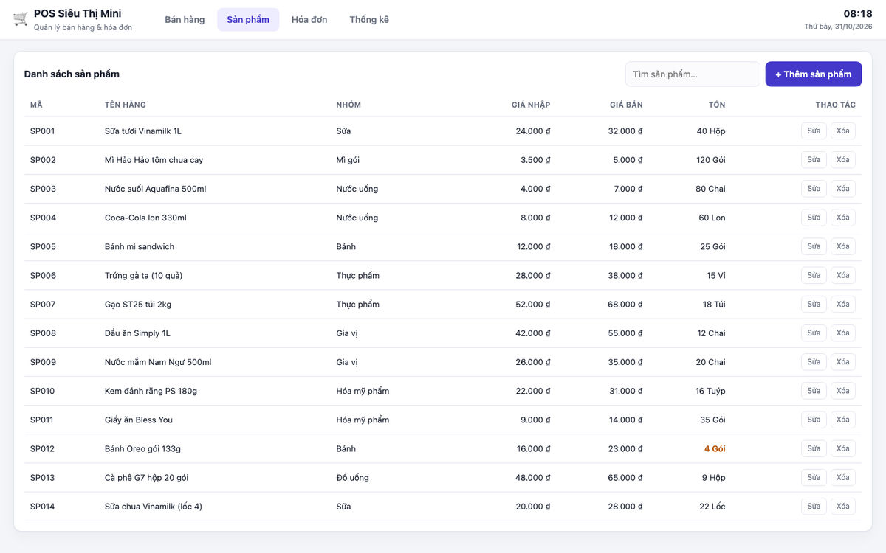
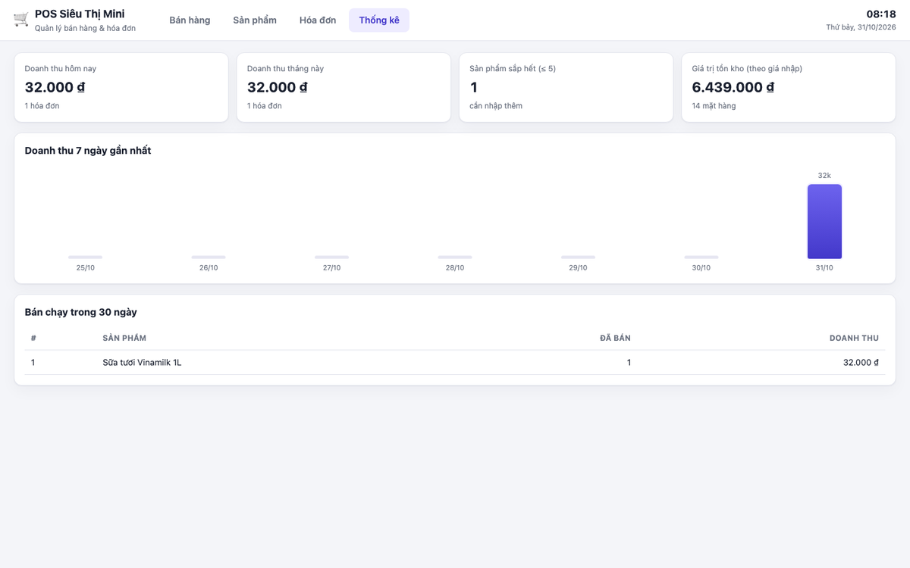

# POS Siêu Thị Mini

Ứng dụng quản lý bán hàng cho siêu thị mini / cửa hàng tiện lợi, chạy trực tiếp trên trình duyệt.
Không cần máy chủ, không cần cài đặt gì — mở file `index.html` là dùng được.

> Đồ án nhỏ môn học — viết bằng HTML, CSS và JavaScript thuần.

## Ảnh chụp màn hình

| Bán hàng | Thanh toán |
|---|---|
|  |  |

| Hóa đơn in | Quản lý sản phẩm |
|---|---|
|  |  |



## Tính năng

**Bán hàng**
- Tìm hàng theo tên hoặc mã, lọc theo nhóm hàng
- Bấm vào sản phẩm để thêm vào hóa đơn, tăng/giảm số lượng, xóa từng món
- Giảm giá theo số tiền, tính tiền khách phải trả
- Thanh toán tiền mặt / chuyển khoản / thẻ; nhập tiền khách đưa và tự tính tiền thối
- Tự trừ tồn kho sau khi bán, chặn bán quá số lượng còn

**Hóa đơn**
- Lưu hóa đơn với mã riêng (dạng `HD20250101-001`), thời gian, khách, hình thức thanh toán
- Xem lại và in hóa đơn khổ nhỏ (in nhiệt 80mm), có phần chân cảm ơn khách
- Lọc hóa đơn theo ngày, xóa hóa đơn

**Sản phẩm**
- Thêm, sửa, xóa sản phẩm: tên, nhóm, đơn vị, giá nhập, giá bán, tồn kho
- Cảnh báo hàng sắp hết (≤ 5) và hàng đã hết
- Tìm kiếm nhanh trong danh sách

**Thống kê**
- Doanh thu hôm nay, doanh thu tháng này, số hóa đơn
- Số mặt hàng sắp hết, giá trị tồn kho theo giá nhập
- Biểu đồ cột doanh thu 7 ngày gần nhất
- Top 8 sản phẩm bán chạy trong 30 ngày

**Khác**
- Dữ liệu lưu trong trình duyệt (localStorage), tắt máy mở lại vẫn còn
- Giao diện dùng được trên điện thoại và máy tính
- Phím tắt: `F2` mở thanh toán, `Esc` đóng hộp thoại

## Cấu trúc thư mục

```
pos-mini-sieu-thi/
├── index.html              # giao diện chính
├── docs/                   # ảnh chụp màn hình cho README
├── assets/
│   ├── css/
│   │   └── style.css       # toàn bộ giao diện, kể cả kiểu in hóa đơn
│   └── js/
│       ├── store.js        # đọc/ghi dữ liệu, tính thống kê
│       └── app.js          # xử lý giao diện và sự kiện
└── README.md
```

## Chạy thử trên máy

Cách 1: mở thẳng file `index.html` bằng trình duyệt (nhấp đúp là được).

Cách 2: chạy một máy chủ tĩnh nhỏ (khuyến nghị, giống môi trường thật):

```bash
cd pos-mini-sieu-thi
python3 -m http.server 8000
```

Sau đó mở http://localhost:8000

## Đưa lên GitHub Pages

1. Tạo repository mới trên GitHub, ví dụ `pos-mini-sieu-thi` (để **Public**).
2. Trong thư mục dự án, chạy:

```bash
git init
git add .
git commit -m "POS sieu thi mini"
git branch -M main
git remote add origin https://github.com/<tên-tài-khoản>/pos-mini-sieu-thi.git
git push -u origin main
```

3. Vào repository trên GitHub → **Settings** → mục **Pages** (thanh bên trái).
4. Ở *Build and deployment*: **Source** chọn `Deploy from a branch`,
   **Branch** chọn `main` và thư mục `/ (root)` → bấm **Save**.
5. Đợi 1–2 phút, tải lại trang Settings → Pages, sẽ có đường dẫn dạng:

```
https://<tên-tài-khoản>.github.io/pos-mini-sieu-thi/
```

Mở đường dẫn đó là dùng được, gửi cho ai cũng xem được.

## Vài điểm cần biết

- **Dữ liệu chỉ nằm trên máy đang dùng.** Vì không có máy chủ, sản phẩm và hóa đơn được lưu
  trong localStorage của trình duyệt. Đổi máy, đổi trình duyệt, hoặc xóa dữ liệu trình duyệt
  là mất. Muốn nhiều máy dùng chung thì phải viết thêm phần máy chủ (Node.js, PHP, Firebase…).
- **Dữ liệu mẫu** gồm 14 mặt hàng, tự nạp ở lần mở đầu tiên.
- **In hóa đơn**: bấm "In hóa đơn" rồi chọn máy in hoặc "Lưu thành PDF". Khổ in đã đặt sẵn
  80mm cho máy in nhiệt; in A4 thì chọn khổ A4 trong hộp thoại in.
- **Mã hóa đơn** tự tăng theo ngày, nên không bao giờ trùng.

## Hướng phát triển thêm

- Xuất/nhập dữ liệu ra file JSON để sao lưu
- Quản lý nhà cung cấp và phiếu nhập hàng
- Tài khoản đăng nhập cho thu ngân và quản lý
- Biểu đồ doanh thu theo ngày
- Chuyển sang máy chủ thật (Node.js + SQLite/Firebase) để nhiều máy dùng chung

## Giấy phép

Dùng tự do cho mục đích học tập.
